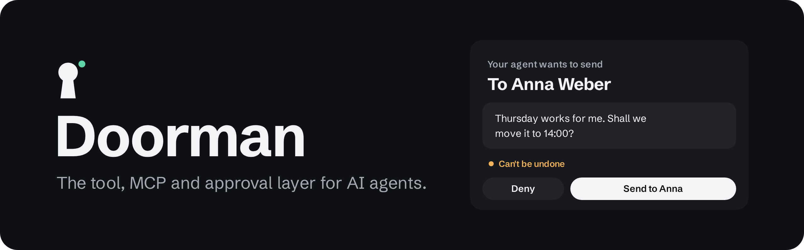
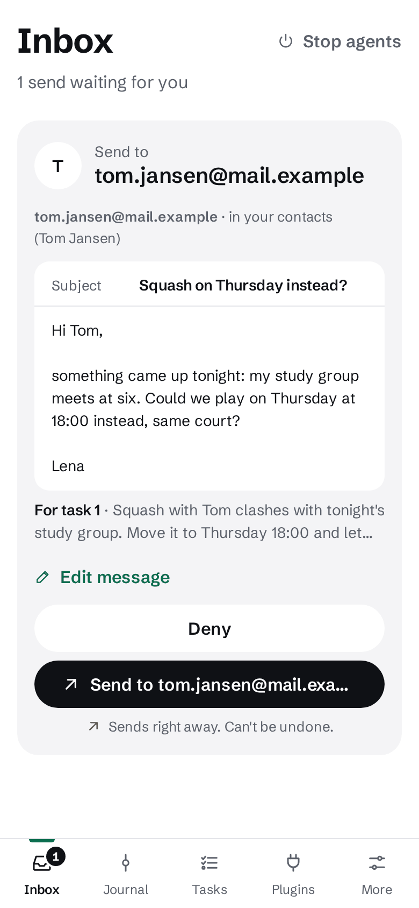
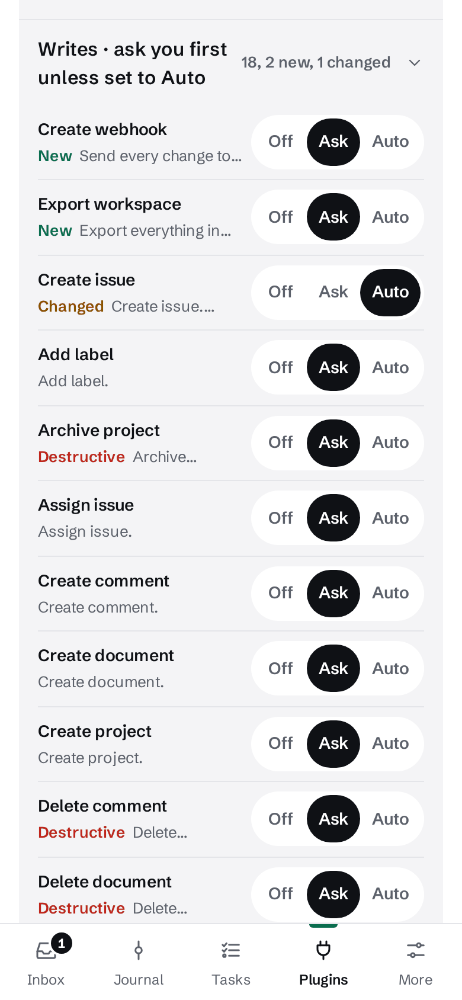
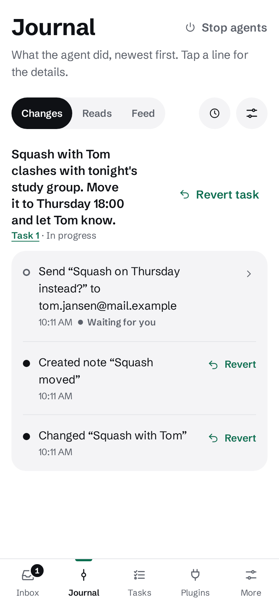
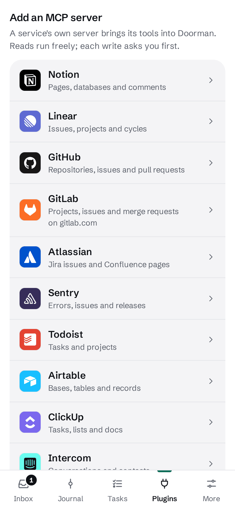
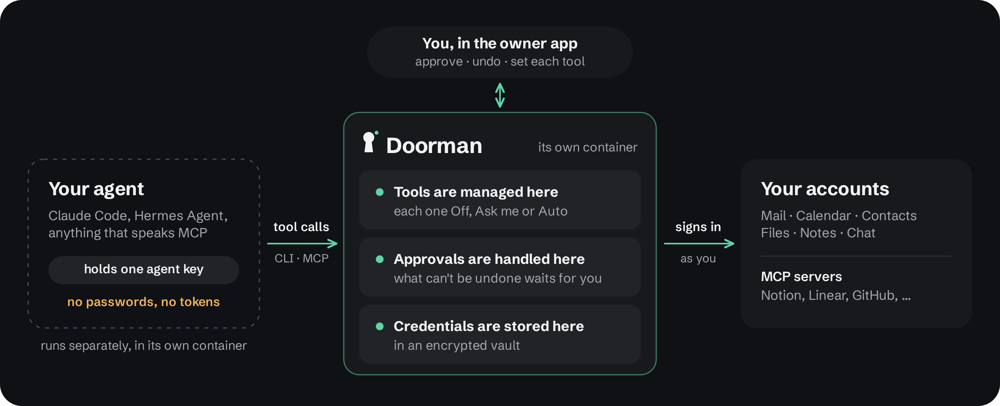

<p align="center"></p>

Doorman is a self-hosted layer between your AI agent and your accounts. Your tools and MCP servers plug
into Doorman, the agent gets them from there, and you set for each tool what it may do without you.
Your passwords and tokens stay in Doorman and never reach the agent.

<table>
  <tr>
    <td></td>
    <td></td>
    <td></td>
    <td></td>
  </tr>
  <tr>
    <td align="center"><b>Approve what<br>can't be undone</b></td>
    <td align="center"><b>A switch per tool</b></td>
    <td align="center"><b>Undo for the rest</b></td>
    <td align="center"><b>MCP servers plug in</b></td>
  </tr>
</table>

## What it does

- **One panel for every tool.** Each tool of each account and MCP server is Off, Ask me or Auto.
- **Approvals on your phone.** A mail, a message, an invitation or an MCP write shows up as a
  notification: send it, edit it or deny it.
- **A journal with undo.** Changes that can be taken back run right away. Revert one, or a whole task.
- **Credentials stay with Doorman.** The agent holds one key, which you can pause or revoke.
- **Sandboxed plugins.** In the Docker image each runs as its own Linux user under Landlock and seccomp.

Also there: one search over everything you connected, questions from the agent that you answer with a
tap, routines and triggers, and one button that stops every agent.

## Architecture

<p align="center"></p>

The agent runs apart from Doorman and holds nothing but its agent key. Doorman manages the tools, handles
the approvals and stores the credentials, so every call passes your settings before it reaches an account.

## Get started

You need Linux, and Docker or Python 3.11 or newer.

```sh
git clone https://github.com/jakobvongehlen/doorman.git && cd doorman
./setup.sh
```

The script asks three things, writes the config and starts Doorman:

- **How it runs:** in Docker, for daily use, or with Python on this machine, which is the quickest to try.
- **Where you open the app:** on this machine, at an HTTPS address you have, or from your network
  without HTTPS.
- **How you sign in:** with a passkey or with a password. Without HTTPS only a password works, and
  browsers then give no notifications.

Then:

1. Open the address it prints and sign in. The Inbox shows the two steps that follow.
2. Under **Plugins**, connect your first account or MCP server.
3. Under **More → Agents → New agent key**, copy the message the app shows and paste it into your
   agent. It sets itself up from there.

[Running Doorman](docs/running.md) has the same steps by hand. To look around without any real account,
`doorman-admin demo` runs Doorman with made-up data
([A demo with made-up data](docs/running.md#a-demo-with-made-up-data)).

## What it connects to

- **Built in:** IMAP and Microsoft 365 mail, Google Calendar, CalDAV calendars and to-do lists, CardDAV
  contacts, calendar feeds, Microsoft Teams, WhatsApp, Nextcloud Notes, local notes and a file archive.
- **MCP servers:** Notion, Linear, GitHub and nine more are a tap away; any other remote server
  connects by its address.
- **Agents:** a command-line client (`doorman`), an HTTP API and an MCP endpoint (`/mcp`). That covers
  Claude Code, Hermes Agent and anything else that runs a command or speaks MCP.

## Optional parts

Off until you switch them on:

- **[Injection guard](docs/third-party-content.md#the-injection-guard):** a local classifier holds back mail,
  files and chats that look like prompt injection.
- **[Network watch](docs/network-watch.md):** an egress proxy logs and filters what the
  agent's own container sends out.
- **[Semantic search](docs/search.md#semantic-search):** finds documents by meaning, across languages.
- **[Reader and actor](docs/reader-actor.md):** one key reads
  outside text and can't write, the other writes and never sees it.
- **A second opinion:** a Claude model reviews each send before it reaches you.

## Status

Early software, written for one person's daily use and run that way. Expect rough edges and changes
between versions. IMAP, CalDAV, Microsoft 365 mail and Google Calendar have run against real servers or
accounts.

Doorman lowers what an agent can do without you; it doesn't make an agent safe.
[How it works](docs/how-it-works.md) writes down the limits, and [SECURITY.md](SECURITY.md) says how to
report a security problem.

## Docs

- [Running Doorman](docs/running.md): Docker or Python, signing in, backups, monitoring, development
- [Connecting agents](docs/agents.md): the command line, MCP, Claude Code, Hermes, tasks and events
- [Setting up plugins](docs/plugins.md): every plugin, Google and Microsoft sign-in, MCP servers
- [How it works](docs/how-it-works.md): what happens to a call, approvals, undo, failures, known gaps
- [Writing a plugin](docs/writing-plugins.md): what a plugin implements and what its sandbox allows

The optional parts and the rest are in the [docs folder](docs/README.md).

MIT licensed ([LICENSE](LICENSE)). What Doorman bundles and downloads from others is listed in
[THIRD_PARTY.md](THIRD_PARTY.md).
